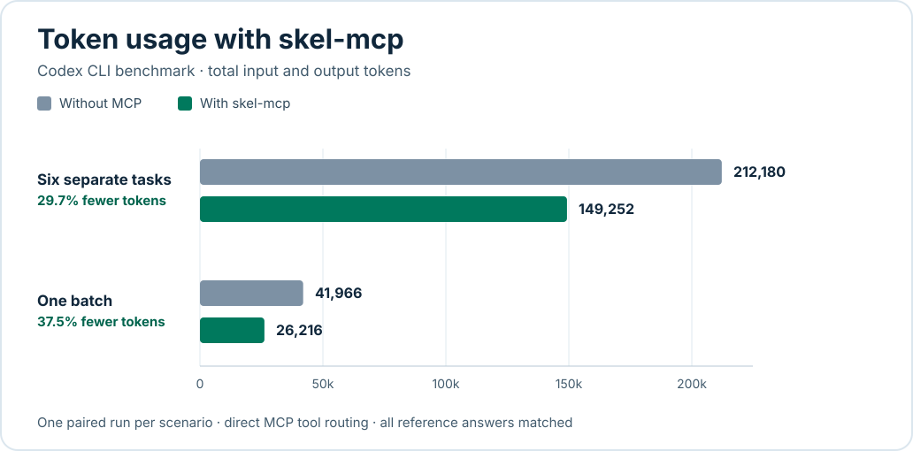

# skel-mcp

**Give coding agents the code they need for the task.**

`skel-mcp` is a local Model Context Protocol server for TypeScript, JavaScript, Python, and Go. One call can retrieve signatures, complete symbol bodies, related types and imports, or the changed lines in a Git working tree. The server uses bundled Tree-sitter grammars and caches syntax trees by file content.

## Token savings

| Codex benchmark | Without MCP | With skel-mcp | Fewer tokens |
| --- | ---: | ---: | ---: |
| Six separate tasks | 212,180 | 149,252 | **29.7%** |
| The same six tasks in one request | 41,966 | 26,216 | **37.5%** |



Each row records one paired run with matching prompts and verified answers. The MCP runs used compact responses and Codex's direct MCP tool configuration. For file tasks the baseline read full files, and for Git tasks it ran `git diff`. Both sides of the batch test retrieved context in one call. Token counts include the agent's input and output. Savings vary by client and task. [Six-task report](benchmarks/results/optimized/report.md) · [Batch report](benchmarks/results/optimized-batch/report.md) · [Methodology](benchmarks/README.md)

## Quick start

Use Node.js 20 or newer. Git operations require `git` on your `PATH`. Start the server from the project you want to analyze, or set the project directory in your client.

```sh
npx --yes skel-mcp@0.2.0
```

The npm command requires the release to be in the registry. For a local build, run `npm install` and `npm pack` in the skel-mcp checkout, then launch the archive from your project:

```sh
npx --yes --package="/absolute/path/skel-mcp-0.2.0.tgz" skel-mcp
```

The first launch may download dependencies. The server waits for MCP requests on stdin and sends protocol messages on stdout.

## Connect a client

For a local archive, replace the `npx` arguments below with `["--yes", "--package=/absolute/path/skel-mcp-0.2.0.tgz", "skel-mcp"]`. You can also run a built checkout with `node` and an absolute path to its `dist/index.js`.

### Claude Code

Run this command from your project directory:

```sh
claude mcp add --transport stdio skel -- npx --yes skel-mcp@0.2.0
```

To share the configuration with your project, put the server in the root `.mcp.json` under `mcpServers`. Claude Code supplies the project directory through `CLAUDE_PROJECT_DIR`. Check the connection in `/mcp`. [Claude Code MCP documentation](https://code.claude.com/docs/en/mcp)

### Cursor

Save this in the project's `.cursor/mcp.json`:

```json
{
  "mcpServers": {
    "skel": {
      "type": "stdio",
      "command": "npx",
      "args": ["--yes", "skel-mcp@0.2.0"],
      "env": {
        "SKEL_MCP_ROOT": "${workspaceFolder}"
      }
    }
  }
}
```

[Cursor MCP documentation](https://cursor.com/docs/mcp)

### Codex

Add this server to `.codex/config.toml` and replace `cwd` with the absolute path to your project:

```toml
[mcp_servers.skel]
command = "npx"
args = ["--yes", "skel-mcp@0.2.0"]
cwd = "/absolute/path/to/project"
```

The benchmark used the optional direct-tool setting in the [example Codex configuration](examples/codex-compact.toml). [Codex MCP documentation](https://learn.chatgpt.com/docs/extend/mcp?surface=cli)

### VS Code and other stdio clients

Use the **stdio** transport with `command` set to `npx` and `args` set to `["--yes", "skel-mcp@0.2.0"]`. Set `cwd` if supported, or pass an absolute project path as `SKEL_MCP_ROOT`. VS Code supports project configuration under `mcpServers` in `.mcp.json` where the Copilot harness offers it. Editor-managed `.vscode/mcp.json` uses a top-level `servers` key. [VS Code MCP configuration](https://code.visualstudio.com/docs/agents/reference/mcp-configuration)

If a Windows client cannot launch `npx` directly, use `"command": "cmd.exe"` with `"args": ["/d", "/c", "npx", "--yes", "skel-mcp@0.2.0"]`.

## One tool, four operations

`get_context` accepts up to 20 requests in a batch. The response labels each result with its request index. Reads are scoped to the configured project directory and exclude Git metadata.

```json
{
  "requests": [
    { "op": "outline", "file": "src/service.ts", "symbol": "Service", "detail": "names" },
    { "op": "symbol", "file": "src/service.ts", "symbol": "Service.run" },
    { "op": "diff" }
  ]
}
```

| Operation | Returns |
| --- | --- |
| `outline` | Signatures and type declarations. Use `detail: "names"` for a shorter list of names. |
| `symbol` | A complete symbol body with related types and imports. |
| `lines` | Line-numbered excerpts around a literal `find` match within a symbol. |
| `diff` | Changed lines labeled by their enclosing AST symbols. Use `detail: "full"` for complete affected bodies. |

Pages default to 1,200 tokens as counted by `o200k_base`. If the response ends with `[truncated next=…]`, repeat the request with that value as `cursor`. Set `maxTokens` to change the page size or pass `null` to retrieve the entire remaining result.

Add `--legacy` to the server arguments to use `get_file_skeleton`, `get_symbol`, and `get_smart_diff` with their original parameters. `--compact` is an alias for the default mode. [Tool reference and type-resolution scope](docs/compact.md)

## Development

```sh
npm install
npm run build
npm test
```

[Benchmark commands and fixtures](benchmarks/README.md) · [MIT license](LICENSE)
