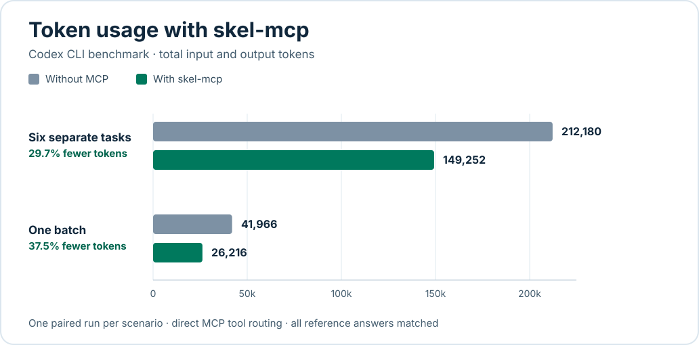

# skel-mcp v0.2.0

**Get the code an agent needs in one MCP call.** This release makes `get_context` the default interface for TypeScript, JavaScript, Python, and Go.

After version 0.2.0 is available in the npm registry, launch it with the following command.

```sh
npx --yes skel-mcp@0.2.0
```

Use Node.js 20 or later. Install Git to use the diff operation. The server runs locally over stdio. See the [setup guide](../README.md#connect-a-client) for Claude Code, Cursor, Codex, and VS Code.

## What's new

- `get_context` batches up to 20 requests for names, signatures, full symbols, selected lines, or AST-aware diffs.
- Symbol responses include relevant imports and related type declarations. TypeScript and JavaScript can follow an unambiguous relative import one step within the workspace. Python and Go resolve declarations in the source file.
- Responses start with a 1,200-token page and include a continuation cursor when more content is available. Set `maxTokens: null` for the full response. Use `detail: "full"` on a diff request for complete affected implementations.
- Source reads are scoped to the configured workspace. The server rejects paths outside the project and paths to Git metadata.
- Start the server with `--legacy` to use `get_file_skeleton`, `get_symbol`, and `get_smart_diff`.

## Benchmark



| Scenario | Without MCP | With skel-mcp | Fewer tokens |
| --- | ---: | ---: | ---: |
| Six separate tasks | 212,180 | 149,252 | **29.7%** |
| The same six tasks in one batch | 41,966 | 26,216 | **37.5%** |

The saved experiment measured total input plus output tokens in Codex CLI with direct MCP tool routing. It ran one paired trial per scenario, and all reference answers matched. The baseline used full-file reads or ordinary Git diffs. Both arms of the batch experiment retrieved their context in one call. Results depend on the workload and the client's tool configuration. [Benchmark method and reports](../benchmarks/README.md)
